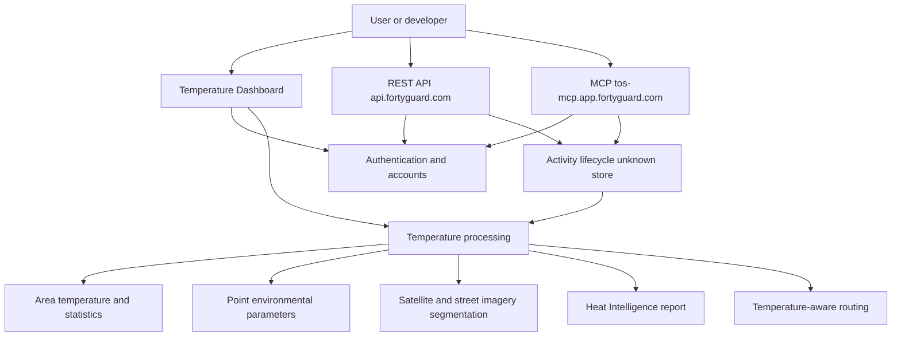

# Architecture analysis

Status: public-surface hypothesis. No internal access. No runtime trace.

This document covers the Phase 1 map and the Phase 6 questions that can be answered before a call is made. Recommendations that depend on a live response stay marked unresolved.

## Observable system

Solid boxes are public entry points or documented outputs. The arrows from the dashboard into processing, and from both API surfaces into one activity store, are hypotheses. The status page is the reason for the hypothesis: authentication stayed up on 17 November 2026 while the dashboard and every processing component went down together. A shared processing dependency is a better fit than five unrelated failures, but the page does not identify that dependency.

## What the docs support

- REST and MCP are separate edges. They use different hosts, different auth headers, and different names for the same jobs.
- REST's documented responsibility is task submission and task status. One status route serves every product.
- MCP's documented responsibility is tool selection by an agent. Three tools submit work, three tools read it back, and three are described as returning immediately.
- Long jobs use an activity identifier. Completed heatmaps can move large GeoJSON off the status payload through `result_delivery=links`. Completed reports return a temporary signed PDF link.
- There is a public `/v1` prefix and no documented sunset or version-negotiation header.
- Plan enforcement is part of the contract. A Basic key is documented to receive `403`, or a validation error, for imagery, reports, and routing.

## What is not claimed

No database product, cloud region, model vendor, or satellite provider is asserted here. Marketing language says the models are NVIDIA-recognized Large Temperature Models and that the measurement height is about 2 metres. A third-party marketplace page adds ground observations, weather stations, terrain, and land cover. Those are inputs FortyGuard talks about publicly. They are not a component inventory.

## Phase 6 notes from the contract alone

| Topic | Observable behavior | Risk if the docs are accurate | What would clarify it |
| --- | --- | --- | --- |
| REST versus MCP | Same capabilities, different names and sync claims | Agents and HTTP clients will implement two lifecycles for one job | One paired call, or the MCP schema showing it wraps `activity_id` |
| Sync versus async | REST: poll. MCP: direct for point and imagery tools, async for heatmap, report, routing | A client that always polls will be wrong on one surface, or a client that expects MCP imagery inline will time out | Runtime timing of `env_params` on each surface |
| Task lifecycle | `Processing`, `Completed`, `Failed`. Quickstart sample also accepts `succeeded` and `error` | Status switches become special cases | One real status payload |
| Identifiers | `activity_id`, `heatmap_id`, `analytics_id` | Read tools become unusable from a REST id without a mapping rule | MCP input schema and one read call |
| Errors | 400/422, 401, 403, 404, 429, 500 are named. Bodies are not | Callers cannot branch on a stable error code | Negative tests in Phase 3 |
| Versioning | Path prefix only | A breaking field rename has no documented client signal | Ask, or watch response headers. Do not invent a version scheme |
| Auth boundaries | API key in two header styles. Dashboard auth stayed up while processing did not | Key leakage is the whole credential. Operationally, login can succeed while the product is down | Confirm the dashboard's empty and error states during or after an outage |
| Response shape | `data` envelope is used in the quickstart and report examples. Other pages describe `Result.map_data` | Two result dialects | Record one completed body before writing a decoder |
| Rate limit | 429 is named. No number, window, or `Retry-After` contract | Clients guess | One 429, or an explicit doc page. Do not generate load to force it |
| Idempotency | Not documented. MCP tells the user not to resubmit while processing | A client timeout can create a second billable job | Ambiguous-timeout test only with permission, and only on the cheap endpoint |
| Observability | Public status page with per-capability uptime | MCP has a month-old open incident and `No data` | Probe MCP when the user approves Phase 4 |
| SDK | Official examples are Python `requests`. This repo uses the official MCP TypeScript SDK against the remote server | No first-party TypeScript API client | Not a defect. It is an onboarding cost |
| Onboarding | Plan matrix, credit-on-success rule, and async diagram are clear | Unit, polygon shape, and identifier conflicts undo that clarity | Phase 5 comparison |

## Preliminary architecture recommendations

These are not the final three. They are the candidates Phase 8 should keep or drop after runtime evidence.

1. Generate REST and MCP contracts from one schema. The activity id, temperature unit, polygon type, and sync flag would then have one definition.
2. Give every submit call an idempotency key, or a documented rule for "HTTP timeout after the server may have accepted the job." The current advice, "do not resubmit while processing," requires the client to have received the id.
3. Split status components only as far as the failure domains are actually split. On 17 November the processing components and the dashboard failed together while authentication did not. Reporting them as eight simultaneous outages is accurate only if they can fail independently. The October MCP incident remaining open is a separate status-quality problem.

Implementation complexity for the first item is moderate if they already share a backend model, and high if MCP was hand-written over REST. That distinction is not visible from outside.
