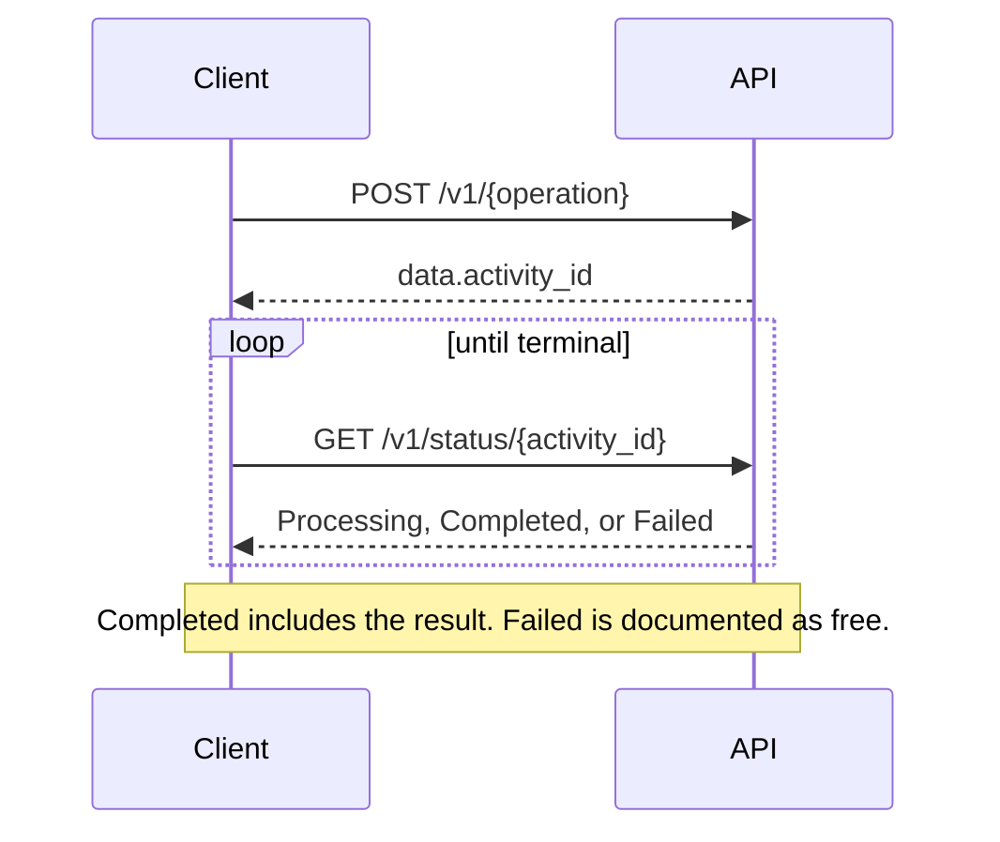

# API phase summary

Historical Phase 3 note. A later `POST /v1/env_params` completed. The current API record is `docs/17-rest-api-functional-evaluation.md`. Do not use the "no POST" sentences below as the current state.

Phase 3 stopped before any processing request. The account plan and the remaining credits were not provided, so the environmental-parameters call stays blocked.

## 1. Overview

The published surface is six POST operations and one shared status read, all on `https://api.fortyguard.com`, authenticated with an `api-key` header. Local fixtures live in `src/api/`. The earlier inventory is `docs/04-api-evaluation.md`.

## 2. Endpoint inventory

| Endpoint | Purpose | Auth | Async | Status | Documented credits | Docs quality |
| --- | --- | --- | --- | --- | --- | --- |
| `POST /v1/heatmap` | Area temperature map | `api-key` | Yes | `GET /v1/status/{activity_id}` | 3,500 Basic/Startup, 4,220 Premium | Partial. Two polygon examples. |
| `POST /v1/env_params` | Point environment | `api-key` | Documented as yes | Same status route | 2,110 Basic/Startup, 2,900 Premium | Partial. Celsius is named on this endpoint. |
| `GET /v1/status/{activity_id}` | Read a job | `api-key` | Read | Itself | 0 in the local inventory. Live calls returned 401 or 404 and no job. | The error text is now observed. The success body is not. |
| `POST /v1/routing` | Temperature-aware route | `api-key` | Yes | Same status route | 3,500 Premium. Not on Basic/Startup. | Partial. 200 km straight-line cap. |
| `POST /v1/heat_intelligence` | PDF report | `api-key` | Yes | Same status route, then a temporary link | 8,600 Premium | Partial. Fahrenheit and Celsius appear on one page. |
| `POST /v1/streetview` | Street segmentation | `api-key` | Yes | Same status route | 8,600 Premium | Partial. |
| `POST /v1/satellite` | Satellite segmentation | `api-key` | Yes | Same status route | 14,400 Premium | Partial. Nested `sat` object. |

Request and response field lists are the indexed ones in `src/api/schemas.ts`. They are fixtures. The success payload of a completed job was not captured.

## 3. Local tests

`npm test` on 17 November 2026: 18 passed, 3 files. `tsc --noEmit` passed.

Covered without the network: both published polygon shapes, a short ring, a MultiPolygon, a missing temperature, an out-of-range latitude, a missing activity id, the published status words, an unknown status word, the paid-call guard, the zero-cost status read, and secret redaction.

These tests check our fixtures. They do not prove the server uses the same rules.

## 4. Live tests

| Call | Result |
| --- | --- |
| `GET /v1/status/does-not-exist` with no key | 401. Message tells the caller to send `api-key`. |
| Same path with a dummy key | 401. Message: invalid or unknown API key. |
| Same path with the account key | 404. Message: no activity found for the provided activity_id. |

Evidence: `evidence/api/errors/2026-11-17-auth-and-unknown-status.md`.

No POST was sent. No `activity_id` value was issued.

## 5. Not performed

| Test | Why |
| --- | --- |
| Bad POST bodies against the live API | A validation failure is documented as free only when the server rejects it. A timeout can still accept a job. Waiting for approval. |
| `POST /v1/env_params` | Documented at 2,110 or 2,900 credits. Plan and balance were not supplied. No spend approval. |
| Heatmap, routing, imagery, reports | More expensive, or premium-only. Out of this pass. |
| Completed-job response body | Requires a finished activity. |
| Credit balance after the 404 | The status body did not include a balance. |

## 6. Authentication

The live header name matches the docs: `api-key`. Missing and invalid keys are different 401 messages, both in the same JSON shape. The account key is recognized, because the same path then returns 404 instead of 401. No second identifier was required on this read.

## 7. Validation

Live validation of POST bodies was not run. The local fixtures reject a latitude of 91, a missing temperature, a three-point ring, and a MultiPolygon. Whether the server agrees is unverified.

## 8. Async processing

Documented lifecycle, not observed on a real job:

The quickstart sample also treats `succeeded` and `error` as terminal. The status table does not. The live 404 confirms the identifier name `activity_id`. It does not confirm the success vocabulary.

Gaps that remain design questions, not reproduced charges: no idempotency key, no documented retry rule for a submit timeout, and no published rate-limit number. A 429 is named. We did not generate one.

## 9. Billing

Documented rule: credits move when status becomes `Completed`. Failed processing and validation failures are documented as free. That rule was not measured, because no job was submitted and the account balance was not returned.

Documented environmental-parameters cost, if a later pass is approved: 2,110 on Basic or Startup, 2,900 on Premium.

## 10. Confirmed findings

No new defect was opened. The live reads did not contradict API-001's REST side: the 404 speaks of `activity_id`.

Still open from the documentation review, and still not runtime-proven:

| ID | What remains true |
| --- | --- |
| API-001 | MCP read tools use `heatmap_id` and `analytics_id`. REST's live error text uses `activity_id`. |
| DOC-002 | Heat Intelligence unit text still disagrees with itself and with MCP. Not exercised. |
| DOC-003 | Two official polygon examples. Not submitted. |
| API-002 | An earlier outage made this same GET time out. It answers now. API-002 stays as the record of that outage, not as the current state. |

## 11. What works

- The error envelope is stable: `error`, `status_code`, and `details.message`. The HTTP status matched the embedded code on all three calls.
- The missing-key message names the header the caller forgot.
- An unknown id is a 404, not a created job.
- The plan matrix and the charge-on-`Completed` rule are specific enough to plan a budget before integrating.
- One status route for every product is a simple client model.

## 12. Three recommendations

1. Publish one machine-readable schema and generate the polygon example, the activity field, and the temperature unit from it. API-001, DOC-002, and DOC-003 are the same class of drift.
2. Put the idempotency rule next to the billing rule. The charge-on-completion sentence does not tell a client what to do when the submit request itself times out.
3. Return the remaining credit balance on the status read, or document the account endpoint that does. This session could prove the key and could not prove the budget.

## 13. Rating

Not scored. Three reads and a documentation pass are enough to draft the design notes. They are not enough to score a processing API that was not asked to process anything.

## 14. Evidence

| Item | Path |
| --- | --- |
| Live 401 and 404 | `evidence/api/errors/2026-11-17-auth-and-unknown-status.md` |
| Earlier timeouts | `evidence/api/errors/2026-11-17-status-read-timeout.md` |
| Indexed contract conflicts | `evidence/documentation/inconsistencies/2026-11-17-indexed-excerpts.md` |
| Local tests | `npm test`, 18 passed |

## 15. Phase 4

MCP was not started. Discovery is a separate pass: connect, list tools, and do not invoke a processing tool until that list is recorded. A paid REST call still needs the plan name, the remaining credits, and an explicit ceiling.
